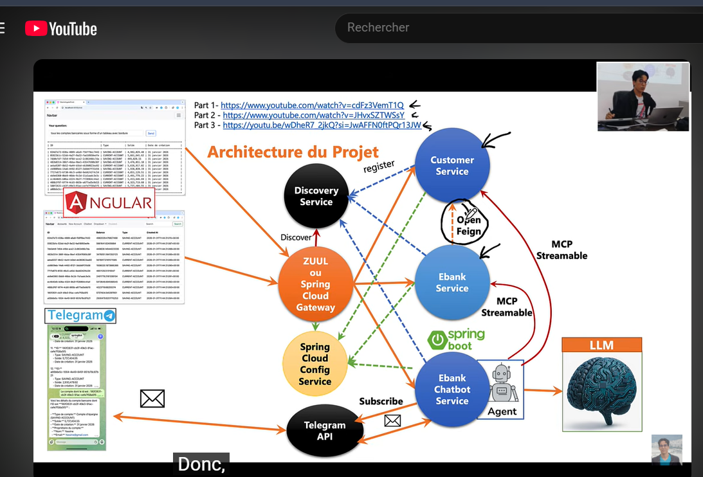

# E-BANK — Architecture micro-services



## Branche `1-microservices`

| Service | Port | Rôle |
|---|---|---|
| `discovery-service` | 8761 | Annuaire Eureka : chaque service s'y enregistre et y découvre les autres |
| `gateway-service` | 8888 | Spring Cloud Gateway : point d'entrée unique, routage vers les services via Eureka (`lb://`), CORS pour le front-end |
| `customer-service` | 8081 | Gestion des clients (CRUD, H2) |
| `ebank-service` | 8082 | Gestion des comptes bancaires et des virements (H2). Récupère les clients via **OpenFeign**, protégé par un **Circuit Breaker Resilience4j** |

Stack : Spring Boot 4.1.2, Spring Cloud 2025.1, Java 25.

### Lancer le projet

Démarrer les services dans cet ordre, chacun dans son terminal (Maven n'a pas besoin d'être installé, `mvnw.cmd` le télécharge) :

```bash
cd discovery-service; .\mvnw.cmd spring-boot:run
cd customer-service; .\mvnw.cmd spring-boot:run
cd ebank-service; .\mvnw.cmd spring-boot:run
cd gateway-service; .\mvnw.cmd spring-boot:run
```

Les services mettent jusqu'à ~30 s à se découvrir via Eureka : pendant ce temps la gateway peut répondre `503`.

### Endpoints (via la gateway, port 8888)

| Méthode | URL | Description |
|---|---|---|
| GET | `/api/customers` | Liste des clients |
| GET | `/api/customers/{id}` | Un client |
| POST | `/api/customers` | Créer un client `{"name", "email"}` |
| PUT / DELETE | `/api/customers/{id}` | Modifier / supprimer un client |
| GET | `/api/accounts` | Liste des comptes, avec leur client |
| GET | `/api/accounts/{id}` | Un compte |
| GET | `/api/accounts/customer/{customerId}` | Comptes d'un client |
| POST | `/api/accounts` | Ouvrir un compte `{"customerId", "type": "CURRENT_ACCOUNT" \| "SAVING_ACCOUNT", "initialBalance", "currency"}` |
| POST | `/api/accounts/transfer` | Virement `{"fromAccountId", "toAccountId", "amount"}` |

Outils : tableau de bord Eureka http://localhost:8761, consoles H2 `/h2-console` sur chaque service (`jdbc:h2:mem:customers-db`, `jdbc:h2:mem:accounts-db`), état des circuits http://localhost:8082/actuator/circuitbreakers.

### Tolérance aux pannes

Si `customer-service` est indisponible :

- les comptes restent consultables, avec un client `"Not available"` (fallback) ;
- l'ouverture d'un compte est refusée (`503`), car le client ne peut pas être vérifié ;
- après 50 % d'échecs sur les 10 derniers appels, le circuit passe `OPEN` : les appels ne sont plus envoyés à `customer-service` pendant 10 s, puis 3 appels d'essai (`HALF_OPEN`) décident de le refermer.

Un client inexistant (`404`) n'est pas compté comme une panne.
